# AWS ECS Fargate Auto Scaling Lab

Hands-on AWS ECS project demonstrating container deployment with Amazon ECR and AWS Fargate, followed by CPU-based ECS Service Auto Scaling.

---

## Overview

This project showcases a complete end-to-end containerized workflow on Amazon Web Services (AWS). A custom web application is containerized using Docker, pushed to Amazon Elastic Container Registry (ECR), and deployed as a serverless container service on Amazon Elastic Container Service (ECS) powered by AWS Fargate.

To ensure high availability and cost efficiency, an **ECS Service Auto Scaling** policy was implemented using **Target Tracking** on average CPU utilization. The lab validates dynamic horizontal scaling under load—scaling from 1 task to 2 tasks, and automatically cooling down and scaling back from 2 tasks to 1 task when demand normalizes.

---

## Architecture

The project architecture consists of two primary flows: the container deployment pipeline and the automated scaling control loop.

### 1. Container Deployment Workflow

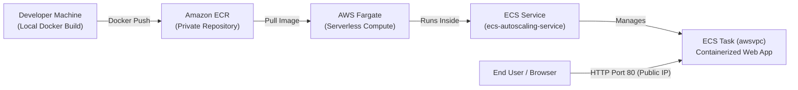

### 2. Auto Scaling Control Loop

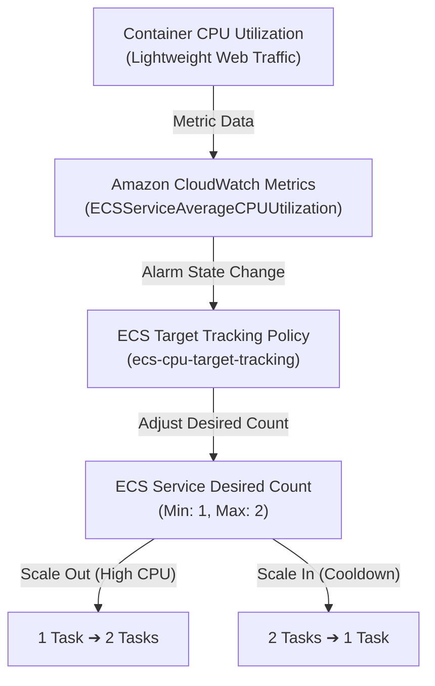

---

## Technologies Used

- **AWS ECS (Elastic Container Service)**: Container orchestration managing task lifecycle and service availability.
- **AWS Fargate**: Serverless compute engine for containers, eliminating the overhead of managing EC2 host instances.
- **Amazon ECR (Elastic Container Registry)**: Secure, private container registry used to store and manage Docker images.
- **Amazon CloudWatch**: Infrastructure monitoring, real-time CPU utilization metrics, and container logging.
- **Docker**: Containerization of the web application and Nginx web server.
- **Git & GitHub**: Version control and documentation for cloud engineering portfolio review.

---

## AWS Resources

The following resources were provisioned and configured during the lab:

| Resource Type | Resource Identifier | Details / Role |
| :--- | :--- | :--- |
| **ECS Cluster** | `ecs-autoscaling-lab` | Fargate cluster hosting serverless tasks |
| **ECR Repository** | `ecs-autoscaling-lab` | Private image repository storing image tag `v1` |
| **Task Definition** | `ecs-autoscaling-task:1` | Fargate specification (0.25 vCPU, 0.5 GiB RAM) |
| **ECS Service** | `ecs-autoscaling-service` | Maintains desired task count and auto scaling |
| **Container** | `ecs-autoscaling-app` | Nginx-based container serving the application |
| **CloudWatch Log Group** | `/ecs/ecs-autoscaling-task` | Centralized container logging stream via `awslogs` |
| **Security Group** | Associated with ECS Service | Inbound TCP port 80 allowed from `0.0.0.0/0` |

---

## Task Definition Configuration

The task definition was registered with lightweight specifications tailored to minimize compute consumption while enabling responsive execution:

- **Launch Type:** AWS Fargate
- **Operating System / Architecture:** Linux / X86_64
- **Network Mode:** `awsvpc` (allocates an Elastic Network Interface and unique private/public IP to each task)
- **Task CPU:** 256 units (`0.25 vCPU`)
- **Task Memory:** 512 MiB (`0.5 GiB`)
- **Task Execution Role:** `ecsTaskExecutionRole` (grants ECS permissions to pull images from ECR and write logs to CloudWatch)
- **Container Port:** `80` (TCP, HTTP)
- **Log Driver:** `awslogs` (streams standard output to `/ecs/ecs-autoscaling-task`)

---

## Container Image

The web application was packaged into a Docker container utilizing Nginx as the lightweight web server:

```dockerfile
# Use the official Nginx image as the base
FROM nginx:latest

# Copy web application assets into the Nginx web root directory
COPY app/ /usr/share/nginx/html

# Expose port 80 for HTTP web traffic
EXPOSE 80
```

The image was built locally, tagged for the AWS ECR registry, and pushed:

```bash
# Build the local Docker image
docker build -t ecs-autoscaling-lab:v1 .

# Authenticate Docker to Amazon ECR (region: ap-south-1)
aws ecr get-login-password --region ap-south-1 | docker login --username AWS --password-stdin <aws-account-id>.dkr.ecr.ap-south-1.amazonaws.com

# Tag the image for ECR
docker tag ecs-autoscaling-lab:v1 <aws-account-id>.dkr.ecr.ap-south-1.amazonaws.com/ecs-autoscaling-lab:v1

# Push the container image to Amazon ECR
docker push <aws-account-id>.dkr.ecr.ap-south-1.amazonaws.com/ecs-autoscaling-lab:v1
```

---

## Deployment

The container was deployed using the AWS ECS console as a replica service:

1. **ECS Service Creation:** `ecs-autoscaling-service` was created within cluster `ecs-autoscaling-lab`.
2. **Launch Type:** Configured for AWS Fargate with `ecs-autoscaling-task:1`.
3. **Networking (`awsvpc`):** Deployed across public subnets with public IP auto-assignment enabled.
4. **Security Group:** Created with an inbound rule allowing HTTP traffic on port 80 from `0.0.0.0/0`.
5. **Direct Task Access:** To avoid the ongoing hourly cost of an Application Load Balancer (ALB) during this lab, the service was directly accessed and tested via the public IP assigned to the Fargate task ENI.

---

## Auto Scaling Configuration

Target Tracking scaling policies automatically adjust the number of running tasks in an ECS service to keep a selected metric at or near a designated target value.

### Policy Details

- **Policy Name:** `ecs-cpu-target-tracking`
- **Policy Type:** Target Tracking Scaling
- **Minimum Tasks:** `1`
- **Maximum Tasks:** `2`
- **Target Metric:** `ECSServiceAverageCPUUtilization`
- **Normal Production Target:** `50%`
- **Scale-Out Cooldown Period:** `60 seconds`
- **Scale-In Cooldown Period:** `60 seconds`

### How Target Tracking Works

1. CloudWatch monitors the `ECSServiceAverageCPUUtilization` metric published by the ECS service.
2. Amazon ECS automatically generates two CloudWatch alarms:
   - **AlarmHigh:** Triggers when CPU utilization exceeds the target threshold, increasing desired task count.
   - **AlarmLow:** Triggers when CPU utilization falls below the target threshold for the cooldown duration, decrementing desired task count.
3. Cooldown periods ensure stability by preventing rapid oscillating scaling decisions ("thrashing").

---

## Scaling Demonstration

### Controlled Test Target (2% vs. 50%)

> [!NOTE]
> **Demonstration Configuration Note:**  
> The standard target configured for this service policy is **50% CPU utilization**. However, because this lab deploys a highly optimized, lightweight static web application on Nginx, normal web browsing produces near 0% CPU consumption.  
> To make the horizontal scaling behavior visibly observable in CloudWatch metrics and ECS activity logs without artificially running intense synthetic stress tools, a **temporary 2% CPU threshold** was applied during testing. This triggered the target tracking policy predictably and demonstrated the complete scale-out and scale-in lifecycle. In a standard production workload, a realistic threshold (e.g., 50%–70%) is utilized.

### Scaling Lifecycle Progression

| Phase | Desired Tasks | Running Tasks | CloudWatch Metric & Status | Action Taken |
| :--- | :---: | :---: | :--- | :--- |
| **Initial State** | **1** | **1** | Baseline CPU utilization (< 1%) | Service steady at minimum capacity |
| **Load Test / Scale-Out** | **2** | **2** | CPU utilization spiked to ~2.97% | `AlarmHigh` triggered policy `ecs-cpu-target-tracking`; desired count incremented to 2 |
| **Cooldown / Scale-In** | **1** | **1** | CPU returned to baseline (< 1%) | `AlarmLow` triggered after cooldown; desired count restored to 1 |

---

## Application Verification

The deployed application was verified live by navigating to the public IP assigned to the running Fargate task:

- **Target URL:** `http://3.110.201.66` (Port 80)
- **Result:** Successfully returned the custom web application interface:
  - Header: `🚀 AWS ECS Containerized Web App`
  - Subtext: `This website is running inside a Docker container.`
  - Interactive Action: Clicking `Click Me` executes JavaScript and displays `✅ Congratulations! Your Docker container is working.`

---

## Screenshots

The following gallery documents each milestone of the project implementation and testing.

### 01. ECS Cluster Created
Active ECS cluster `ecs-autoscaling-lab` provisioned with AWS Fargate capacity, showing the active service running.
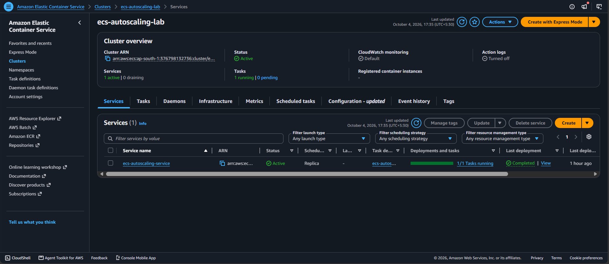

---

### 02. Amazon ECR Repository
Private container repository `ecs-autoscaling-lab` in Amazon ECR with the pushed `v1` image tag.
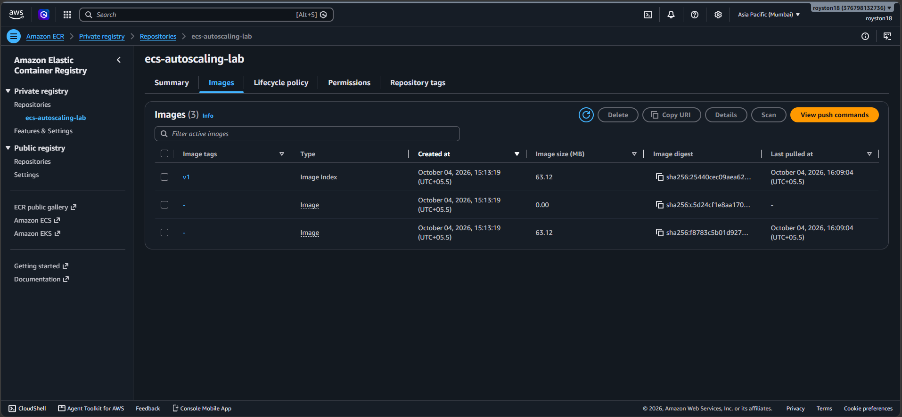

---

### 03. Docker Image Pushed
Local Docker environment displaying the container image built and tagged with the Amazon ECR registry URI.
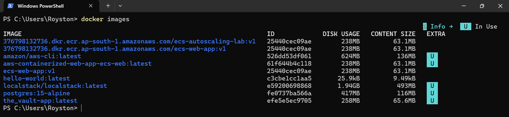

---

### 04. ECS Task Definition
Task definition `ecs-autoscaling-task:1` configured for AWS Fargate with `Linux/X86_64`, `0.25 vCPU`, `0.5 GiB` RAM, and `awsvpc` network mode.
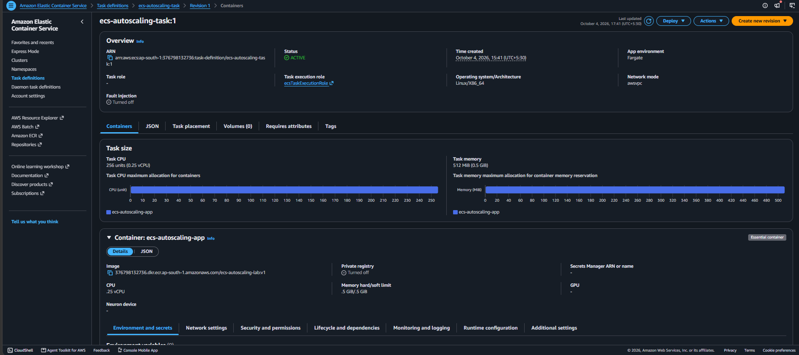

---

### 05. ECS Service Running
Service overview for `ecs-autoscaling-service` showing active status, successful deployment, and 1 running task.
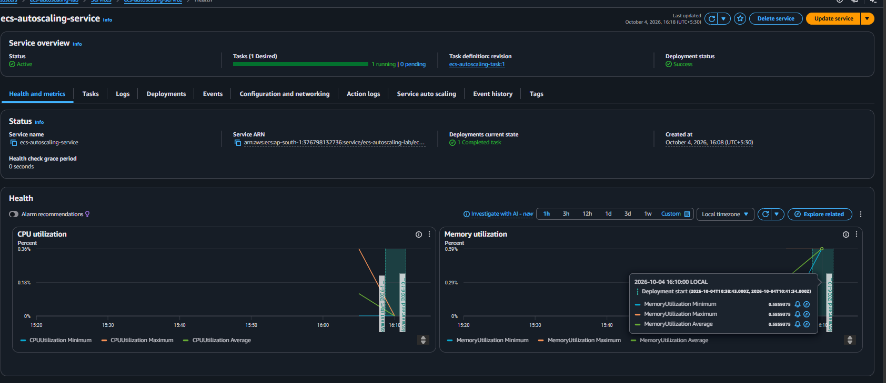

---

### 06. Web Application Working
Containerized web application accessed directly via the ECS task public IP (`3.110.201.66`) on port 80.
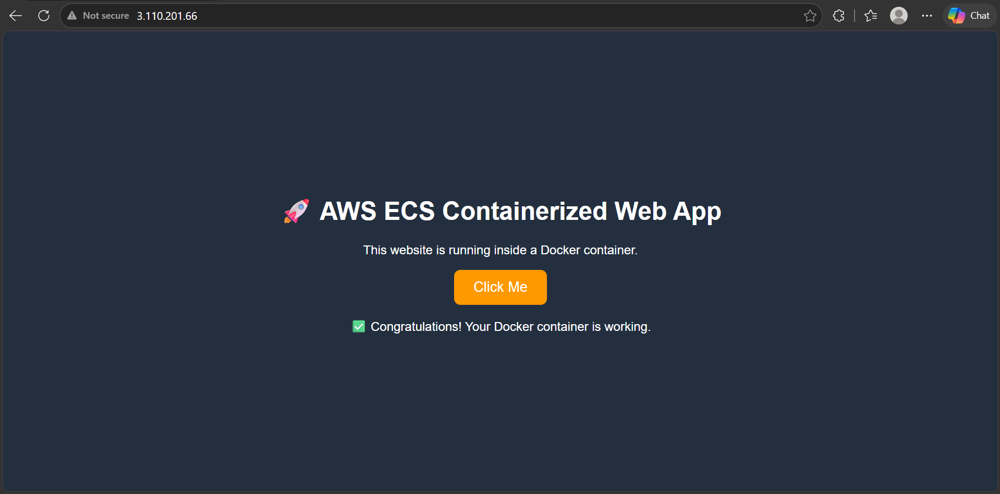

---

### 07. Auto Scaling Policy & Scaling Activities
Target tracking policy `ecs-cpu-target-tracking` configured with the activity history showing automated scaling decisions triggered by CloudWatch alarms.
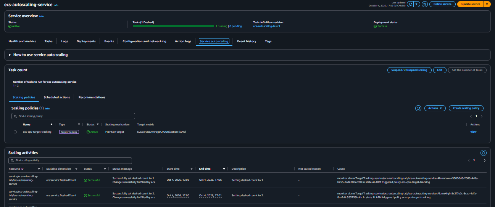

---

### 08. Auto Scaling Scale-Out (1 ➔ 2 Tasks)
CloudWatch metrics graph illustrating CPU utilization exceeding the test threshold, triggering a scale-out event to 2 desired and running tasks.
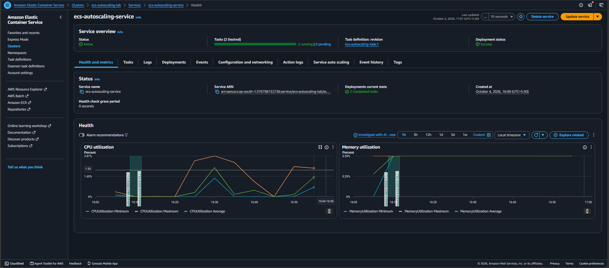

---

### 09. Auto Scaling Scale-In (2 ➔ 1 Task)
CloudWatch metrics graph illustrating CPU utilization returning to baseline, triggering the scale-in cooldown and restoring capacity to 1 running task.
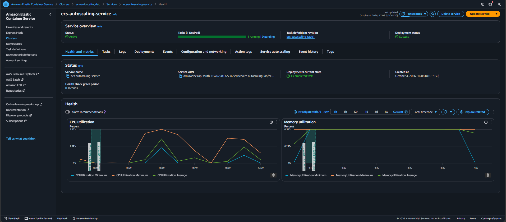

---

## Key Learning Outcomes

Through this project, the following core Cloud and DevOps competencies were demonstrated:

- **Container Image Lifecycle:** Crafting efficient multi-layer Dockerfiles, containerizing web apps, and maintaining image version tags.
- **Amazon ECR Management:** Creating private container registries, managing authentication tokens, and pushing container images securely.
- **ECS Task Definitions:** Configuring execution roles, network modes (`awsvpc`), port mappings, and container resource limits (CPU/Memory).
- **Serverless Compute with Fargate:** Running container workloads without managing or patching underlying EC2 host servers.
- **Cloud Networking & Security:** Configuring VPC subnets, public IP assignment, and Security Group ingress rules for HTTP traffic.
- **Observability with CloudWatch:** Streaming container logs using the `awslogs` driver and analyzing real-time CPU/Memory utilization charts.
- **Target Tracking Scaling:** Setting up automated horizontal scaling rules, defining cooldown windows, and monitoring alarm triggers.
- **Cost Awareness & Resource Hygiene:** Designing infrastructure to prevent unnecessary cloud expenditures and executing proper resource decommissioning.

---

## Cost Awareness

Cloud financial prudence was an essential design principle throughout this lab:

- **Minimal Fargate Task Sizing:** Utilized the lowest available Fargate tier (0.25 vCPU and 0.5 GiB memory) to minimize per-second compute billing.
- **Strict Scaling Bounds:** Capped the maximum task count to 2, ensuring runaway scaling cannot incur unexpected charges.
- **Direct Task Public IP Testing:** Tested the containerized application directly via the task public IP, intentionally avoiding the hourly base cost of an Application Load Balancer (ALB).
- **No NAT Gateway:** Kept tasks in public subnets with direct internet access, avoiding hourly NAT Gateway charges.
- **Standard CloudWatch Metrics:** Avoided high-resolution custom metrics to prevent additional monitoring fees.
- **Decommissioning:** Resources were designed for immediate cleanup after testing to keep overall expenditure to near-zero.

---

## Cleanup

To avoid ongoing AWS charges after completing the demonstration, resources should be deleted in the following order:

1. **ECS Service:** Update the service desired count to `0` and delete `ecs-autoscaling-service`.
2. **ECS Cluster:** Delete the `ecs-autoscaling-lab` cluster.
3. **CloudWatch Log Group:** Delete `/ecs/ecs-autoscaling-task` to prevent log storage costs.
4. **ECR Repository:** Delete repository `ecs-autoscaling-lab` and associated container images.
5. **Security Group:** Remove the custom security group once all Elastic Network Interfaces (ENIs) have been released by AWS Fargate.

---

## Repository Structure

```text
aws-ecs-autoscaling/
├── .gitignore
├── Dockerfile
├── LICENSE
├── README.md
├── app/
│   ├── index.html
│   ├── script.js
│   └── style.css
└── Screenshots/
    ├── 01-ecs-cluster-created.png
    ├── 02-ecr-repository.png
    ├── 03-ecr-image-pushed.png
    ├── 04-ecs-task-definition.png
    ├── 05-ecs-service-running.png
    ├── 06-web-app-working.png
    ├── 07-auto-scaling-policy.png
    ├── 08-auto-scaling-scale-out.png
    └── 09-auto-scaling-scale-in.png
```
